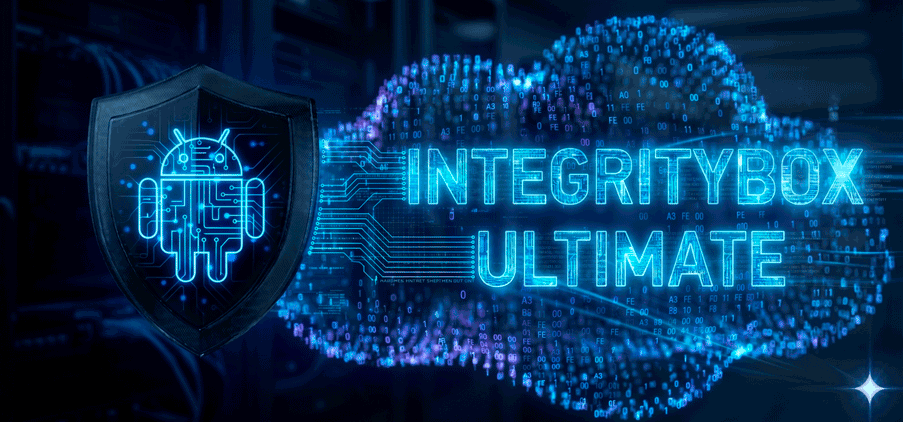

  

 

  
  &nbsp;&nbsp;&nbsp;&nbsp;&nbsp;&nbsp;
  
  &nbsp;&nbsp;&nbsp;&nbsp;&nbsp;&nbsp;
  
  &nbsp;&nbsp;&nbsp;&nbsp;&nbsp;&nbsp;
  
  &nbsp;&nbsp;&nbsp;&nbsp;&nbsp;&nbsp;
  

---

<h1 align="center">IntegrityBox Ultimate</h1>

  <b>Набор инструментов для сертификации, Keybox и приватности Android</b>

  
  
  

## 📌 Обзор
**IntegrityBox Ultimate** - это удобный набор инструментов для Android с root-доступом: он помогает вернуть сертификацию Play Store, управлять Keybox, очищать следы Google-сервисов, настраивать скрытие приложений и проверять состояние устройства через понятный интерфейс в стиле Material You.

### ✨ Основные возможности
* ️ **Play Integrity в одном месте:** управление PIF, Keybox, Target List, Boot Hash и Security Patch без установки нескольких конфликтующих модулей.
* 🛰 **RKP-ключ устройства:** на поддерживаемых устройствах (Android ARM64, проверено на Qualcomm) модуль получает собственный RKP-ключ телефона от Google и применяет его в SLOT 1 вместо Keybox из пула. Ключ проверяется на отзыв и сроки, AutoPilot выпускает новый по окончании срока, а если выпуск не удался, применяется ключ из пула.
* 🔑 **Keybox Loader:** каталог Keybox из онлайн-источников, кэширование, локальный импорт XML из `/sdcard/Download` и `/sdcard/Documents`, выбор активного ключа и проверка его состояния в **Проверке целостности**. Применённый ключ, выбранный вручную или автоматически, закрепляется и держится, пока он есть в каталоге, его сертификаты действуют и отзыв не обнаружен; более свежий ключ его не вытесняет. Когда ключ истекает, отзывается или пропадает из каталога, модуль берёт самый свежий актуальный.
* 🚫 **Проверка Keybox на отзыв и сроки:** ключи сверяются с бан-листом сертификатов Google, а сроки сертификатов проверяются без сети. Каждый Keybox помечается **АКТУАЛЕН / ОТОЗВАН / ПРОСРОЧЕН / НЕ ПРОВЕРЕН**, отозванные и просроченные исключаются из автовыбора. Если подходящих ключей нет, текущий остаётся применённым (отозванный ещё несколько дней проходит, пока GMS не синхронизирует бан) и сменится, как только появится актуальный. Используется только публичный общий список: он скачивается, сверяется локально и удаляется - ваш конкретный ключ никуда не отправляется и потому не может ускорить собственный бан.
* 🧩 **Все популярные бэкенды аттестации:** TrickyStore, TrickyStoreOSS, TrickyStore от qwq233, TEESimulator (v1-v3, RS и v4) и OhMyKeymint подключаются через собственные драйверы. Интерфейс показывает только настройки, которые поддерживает установленный бэкенд, а при смене бэкенда список приложений, Keybox и дата патча переносятся без сети.
* 👥 **Несколько пользователей Android:** Target Box, Spoof Apps и App Data Cleaner работают с рабочим профилем, клонами приложений и личным пространством - по отдельности или для всех пользователей сразу.
* 🧬 **Fingerprint Selector:** пул из 5 случайных моделей Pixel с реальными уровнями API, переключатель **Случайный выбор** или закреплённая модель, обновление по расписанию и ручное применение профиля. Pixel 10 и новее в пул не попадают: им нужен Keybox, выданный через RKP.
* ⚙️ **Движок подмены без перехвата:** системные свойства подменяются в собственных копиях областей свойств, без перехвата системных функций (архитектура inject_s от KOWX712). Поддерживаются arm64, armeabi-v7a, x86_64 и Android 17.
* 🎯 **Target Box:** автоматическая сборка Target List из облачного шаблона, защищённый ручной режим, импорт JSON с предпросмотром изменений и резервное копирование. Если бэкенд это поддерживает, приложениям назначаются профиль и режим аттестации; в TEESimulator v4 режим PATCH или GENERATE выбирается для каждого приложения.
* 🗓️ **Security Patch:** дата патча из Fingerprint-профиля, своя дата через выбор в календаре или стоковый патч прошивки. В режиме подмены система, vendor и boot получают в аттестации одну и ту же дату.
* 🔓 **Boot Hash Spoofer:** извлечение реального Boot Hash устройства и подмена сохранённым значением для приложений, которые проверяют состояние загрузчика или VBMeta. Размер VBMeta, алгоритм хэша и версия AVB остаются такими, какими их сообщает загрузчик.
* 🛡️ **TEE / Widevine инструменты:** диагностика состояния TEE, работа с backend’ом аппаратной аттестации и попытка восстановления Widevine L1 на поддерживаемых устройствах.
* 🧹 **Спуф ROM Props:** автоматическая и ручная очистка следов 30+ кастомных прошивок: LineageOS, crDroid, Evolution X, DerpFest, RisingOS, AOSPA, PixelExperience, Pixel, GrapheneOS, CalyxOS, PixelOS, ArrowOS, StatiX и другие (Generic - для остальных случаев).
* 🎭 **Spoof Apps:** точечная подмена Fingerprint и свойств устройства для отдельных сторонних приложений - помимо GMS и Play Store. Полезно для приложений, которые проверяют `Build`-поля локально в обход вердикта Play Integrity. Приложения с защитой PairIP, которым подмена ломает запуск, исключаются автоматически.
* 🕶️ **Скрытие root-окружения:** готовый шаблон HideMyApplist для HMA, HMAL и HMA-OSS, скрытие подозрительных файлов и папок, очистка следов TWRP/Fox/Magisk, **Скрыть лишние менеджеры** и Anti-Detection Nuke. Модуль не создаёт системные свойства, которых нет в прошивке.
* 🧰 **GMS Tools:** мягкий перезапуск Google Play Services/Play Store со сбросом кэша GMS, включая кэш вердикта DroidGuard - без него перезапуск переигрывает старый результат, и смена настроек спуфинга выглядит как неработающая. Плюс сброс данных Google Wallet и глубокая очистка GMS/Play Store/GSF для повторной подготовки устройства к проверке Play Маркета.
* 🧼 **App Data Cleaner:** очистка данных и кэша отдельно выбранных приложений, включая системные - удобно после смены HMA, Target-профиля, props или Boot Hash, чтобы приложение заново проверило окружение. Пакеты, полный сброс которых способен обнулить системные настройки, оборвать мобильную сеть или отправить устройство в bootloop, заблокированы от случайного стирания; очистка кэша при этом доступна для любого пакета. Очистка выполняется у выбранного пользователя Android.
* 🤖 **AutoPilot:** фоновое обслуживание Keybox, RKP-ключа, PIF, Target Box и патчей безопасности по расписанию без ручной рутины. Расписание привязано к фиксированной сетке, поэтому цикл не сползает со временем в ночь, а обновление, выпавшее на офлайн, не пропадает: попытка повторяется каждый час, пока связь не появится, вместо ожидания целых суток.
* 📦 **Integrity Downloader:** выборочная загрузка полезных APK/ZIP/JSON-инструментов прямо из WebUI.
* 📊 **Проверка целостности и Центр помощи:** проверка активного Keybox, PIF, TEE, Target Box, сопутствующих модулей, сетевого доступа и экспорт диагностического архива для поддержки.
* 🎨 **Удобный WebUI:** Material You интерфейс, главная из 7 разделов по назначению с поиском по плиткам, быстрый доступ к избранным плиткам, локализация, справка внутри модулей и встроенный AI Assistant.

### 🧭 Быстрая навигация
* **Ставите модуль впервые?** Начните с раздела [Установка и полное руководство по настройке](#-установка-и-полное-руководство-по-настройке).
* **Не знаете, что нужно удалить перед установкой?** Смотрите [Конфликтующие модули](#️-конфликтующие-модули-которые-нужно-удалить-или-отключить).
* **Нужны бэкенд аттестации, Zygisk, HMA или другие инструменты?** Смотрите [Основные требования](#-основные-требования), [Дополнительные, но настоятельно рекомендуемые](#-дополнительные-но-настоятельно-рекомендуемые) и [Integrity Downloader](#-полезные-инструменты-из-integrity-downloader).
* **Хотите вручную контролировать Target List?** Смотрите [Ручное управление Target List](#-ручное-управление-target-list).
* **Что-то не проходит или приложение видит root?** Смотрите [Быстрое решение проблем](#️-быстрое-решение-проблем).

---

## 🧩 Основные требования

Для комфортной работы и максимальной скрытности убедитесь, что окружение собрано без конфликтующих root-движков, backend’ов аттестации и лишних следов в пользовательском профиле.

1. **Root-решение.** Рекомендуемый порядок для устройств, где важна работа банковских и государственных приложений:

   - **Предпочтительно:** [**SukiSU Ultra**](https://github.com/SukiSU-Ultra/SukiSU-Ultra/releases/latest) или [**KernelSU Next**](https://github.com/KernelSU-Next/KernelSU-Next/releases/latest). Этого достаточно для работы модуля; при необходимости антидетект дополнительно усиливается **SUSFS** (опционально, см. раздел «Дополнительные, но настоятельно рекомендуемые»).

   - **Альтернатива:** [**APatch**](https://github.com/bmax121/APatch/releases/latest), если для устройства нет стабильного KernelSU/SukiSU-ядра или требуется kernel-based root без Magisk-подобной схемы.

   - **Fallback-вариант:** [**Kitsune Magisk / Kitsune Ufork**](https://t.me/KitsuneUfork). Используйте его только если KernelSU Next, SukiSU Ultra или APatch недоступны для вашего устройства. Для строгих банковских приложений стабильная работа на Kitsune не гарантируется, так как Magisk-подобные окружения чаще оставляют видимые следы.

   Используйте только **одно** root-решение одновременно. Не смешивайте Magisk/Kitsune, KernelSU Next, SukiSU Ultra и APatch в одной системе без полного понимания последствий.

2. **Backend для аппаратной аттестации.** Установите один из поддерживаемых бэкендов: [**TrickyStore**](https://github.com/5ec1cff/TrickyStore/releases/latest), [**TrickyStoreOSS**](https://github.com/beakthoven/TrickyStoreOSS/releases/latest), [**TrickyStore от qwq233**](https://github.com/qwq233/TrickyStore/releases/latest), [**TEESimulator**](https://github.com/JingMatrix/TEESimulator/releases/latest), [**TEESimulator-RS**](https://github.com/Enginex0/TEESimulator-RS/releases/latest) или [**OhMyKeymint**](https://github.com/qwq233/OhMyKeymint/releases/latest). Модуль сам определяет установленный бэкенд при установке и при каждой загрузке и показывает только поддерживаемые им настройки. Без бэкенда модуль ничего не применяет, а в статусе бэкенд отображается как `НЕ ОПРЕДЕЛЕН`.

   Используйте только **один** backend аттестации. Перечисленные бэкенды и их форки не должны работать одновременно.

3. **WebUI.** Для открытия панели управления установите [**MMRL**](https://github.com/MMRLApp/MMRL/releases/latest), [**WebUI X Portable**](https://github.com/MMRLApp/WebUI-X-Portable/releases/latest) или используйте встроенную поддержку WebUI в root-менеджере.

   Если WebUI не открывается напрямую, заранее установите [**KsuWebUIStandalone**](https://github.com/KOWX712/KsuWebUIStandalone/releases/latest) вручную как fallback-вариант. После первого входа в WebUI его APK также можно скачать через Integrity Downloader.

4. **Метамодули монтирования.** IntegrityBox Ultimate сам по себе не требует отдельный metamodule ради своей работы. Он нужен только если у вас есть другие systemless-модули, которые реально монтируют файлы в `/system`, `/vendor`, `/product`, `/system_ext`, `/odm` и похожие разделы.

   Если используете KernelSU/APatch с metamodule, держите активным только одно решение монтирования одновременно. IntegrityBox Ultimate выставляет маркеры исключения `skip_mount` и `skip_mountify`, чтобы такие решения не пытались обрабатывать его как модуль с системным mount-пayload. Состояние metamodule-подсистемы попадает в диагностический отчет.

## ⚠️ Конфликтующие модули, которые нужно удалить или отключить

> [!IMPORTANT]
> Перед установкой удалите другие модули и решения для починки Integrity / Play Integrity сертификации, чтобы они не конфликтовали с IntegrityBox Ultimate.

> [!CAUTION]
> Не смешивайте несколько модулей, которые одновременно меняют Keybox, fingerprint, GMS-состояние, DroidGuard, VBMeta или Play Integrity verdicts. Такие конфликты часто дают нестабильную сертификацию и ложные срабатывания банковских приложений.

<ul>
  <li><b>🧬 Play Integrity / DroidGuard spoofers:</b> PlayIntegrityFix / PIF, Play Integrity Fix Next / PlayIntegrityFix-NEXT, Play Integrity Fork / PIFork, PlayIntegritySuperFork, Play Integrity Fix Advanced, Strong Integrity Fix, SafetyNet Fix, Universal SafetyNet Fix, Displax SafetyNet Fix и другие PIF/SafetyNet-форки.</li>
  <li><b>🧰 All-in-one решения для Integrity / Keybox:</b> Integrity-Box, Integrity Box forks, старые сборки IntegrityBox, Tricky Addon, Tricky Addon Enhanced / Update Target List и аналоги, если они самостоятельно управляют keybox, target.txt, security patch, VBHash или GMS-состоянием.</li>
  <li><b>🔑 Key attestation / Keybox backend:</b> не держите одновременно TrickyStore, TrickyStoreOSS, TrickyStore от qwq233, TEESimulator, TEESimulator-RS, OhMyKeymint и их форки. Оставьте только тот backend, который выбран для работы с IntegrityBox Ultimate.</li>
  <li><b>🧾 Build props / fingerprint / security patch spoofers:</b> MagiskHide Props Config, Sensitive Props, Pixel Props / build.prop, Build-Prop-BETA, PixelFlasher PIF helper, XiaomiEU Injected PIF и любые ROM-встроенные PIF / Pixel props spoof.</li>
  <li><b>📱 Pixel spoofing modules:</b> Pixelify, Pixelify Next, Pix3lify, Pixel Features, Google Photos Unlimited Backup и похожие модули, если они меняют <code>ro.product*</code>, fingerprint, model, brand, security patch или свойства GMS.</li>
  <li><b>🧱 VBMeta / boot hash spoofers:</b> Android VBMeta Fixer, VBMeta Disguiser и аналоги, если одновременно используются функции IntegrityBox Ultimate для Boot Hash / verifiedBootHash / VBMeta.</li>
  <li>Другие модули, которые меняют fingerprint, build props, GMS-состояние, DroidGuard, Keybox, attestation, security patch, VBMeta, boot hash или Play Integrity verdicts.</li>
</ul>

## 🚨 Важно для пользователей классического Magisk Stable

> [!WARNING]
> Классический [**Magisk Stable**](https://github.com/topjohnwu/Magisk/releases/latest) не является рекомендуемым вариантом для IntegrityBox Ultimate, если цель - стабильная работа банковских приложений и строгих проверок окружения. Настоятельно рекомендуется перейти на [**Kitsune Magisk / Kitsune Ufork**](https://t.me/KitsuneUfork) или на [**KSU Next Spoofed**](https://github.com/KernelSU-Next/KernelSU-Next/releases/latest) *(в релизах выбирайте APK с `-spoofed_...-release.apk`)*, иначе стабильная работа банковских приложений не гарантируется.

## ➕ Дополнительные, но настоятельно рекомендуемые

1. [**Zygisk Next**](https://github.com/Dr-TSNG/ZygiskNext/releases/latest) или [**ReZygisk**](https://github.com/PerformanC/ReZygisk/releases/latest), а также их форки *(нужны для функций на базе Zygisk, если вы не используете Zygiskless Mode)*.
2. [**LSPosed / Vector**](https://github.com/JingMatrix/Vector/releases/latest) и [**HideMyApplist / HMA-OSS**](https://github.com/frknkrc44/HMA-OSS/releases/latest) *(рекомендуются, если банковские или государственные приложения реагируют на список приложений, root-следы или установленные модули)*. Альтернативная ветка HMA: [**Hide-My-Applist**](https://github.com/Dr-TSNG/Hide-My-Applist/releases/latest).
3. **SUSFS** *(опционально, для максимальной скрытности).* Дополнительный инструмент kernel-level скрытия поверх SukiSU Ultra или KernelSU Next. Для базовой работы модуля не требуется, но усиливает антидетект против самых строгих проверок. Нужны не только Manager APK, а ядро/AnyKernel3/boot-образ со встроенными SUSFS-патчами под конкретное устройство, версию Android, ветку ядра и прошивку; после прошивки такого ядра установите userspace-модуль [**susfs4ksu / SUSFS-FOR-KERNELSU**](https://github.com/sidex15/susfs4ksu-module/releases/latest). Простое патчирование `boot.img`/`init_boot.img` через Manager даёт root, но не гарантирует SUSFS: без патчей в ядре модуль `susfs4ksu` не включит kernel-level скрытие.

## 📦 Полезные инструменты из Integrity Downloader

> [!TIP]
> Integrity Downloader больше не скачивает весь набор вслепую. После включения плитки **Integrity Downloader** и нажатия **Применить изменения** появится окно выбора: отметьте чекбоксами только нужные утилиты и нажмите **Скачать выбранное**. После подтверждения откроется терминальное окно с прогрессом загрузки.

Текущий список из `assets/tools.list`:

* **ZygiskNext.zip** - актуальный Zygisk Next для Root-менеджеров без встроенного Zygisk.
* **TrickyStore.zip** - backend для аппаратной аттестации (оригинал, 5ec1cff).
* **TrickyStore_OSS.zip** - тот же backend, активно поддерживаемый FOSS-форк (beakthoven). Ставится вместо оригинала, не вместе с ним (один и тот же id модуля `tricky_store`).
* **KeyAttestation.apk** - приложение для ручной проверки сертификатов и verdict-данных.
* **UpdateLocker.apk** - LSPosed-модуль для блокировки нежелательных обновлений приложений.
* **HMA_Config.json** - готовый профиль IntegrityBox для HideMyApplist.
* **HMA_OSS.zip** - актуальная сборка HideMyApplist OSS (прошивается в Root-менеджере).
* **PixelMask.apk** - LSPosed-модуль для Pixel/GMS-сценариев.
* **KSU_WebUI.apk** - отдельное приложение WebUI для устройств, где Root-менеджер не открывает WebUI напрямую.
* **Core_Patch.apk** - LSPosed-модуль для патча системных ограничений установки/подписи.
* **Thor_Installer.apk** - менеджер/инсталлер для дополнительных Android-инструментов.
* **Android_Faker.apk** - утилита для ручной проверки и настройки Android-идентификаторов.
* **LSPosedVector.zip** - LSPosed / Vector для работы HMA и других LSPosed-модулей.
* **Duck_Detector.apk** - детектор root/Xposed/Magisk с нативными проверками; полезен для диагностики обнаружения рут-среды.
* **Native_Root_Detector.apk** - нативный детектор рут, показывающий что именно приложения могут видеть при низкоуровневом сканировании.

## 📁 Где искать файлы, скачанные через Integrity Downloader

> [!NOTE]
> Все выбранные APK/ZIP/JSON, скачанные через Integrity Downloader, сохраняются в `/sdcard/IntegrityBox/Downloads`.

| Инструмент | Имя файла | Полный путь |
| --- | --- | --- |
| Zygisk Next | `ZygiskNext.zip` | `/sdcard/IntegrityBox/Downloads/ZygiskNext.zip` |
| Tricky Store | `TrickyStore.zip` | `/sdcard/IntegrityBox/Downloads/TrickyStore.zip` |
| Tricky Store OSS | `TrickyStore_OSS.zip` | `/sdcard/IntegrityBox/Downloads/TrickyStore_OSS.zip` |
| Key Attestation | `KeyAttestation.apk` | `/sdcard/IntegrityBox/Downloads/KeyAttestation.apk` |
| Duck Detector | `Duck_Detector.apk` | `/sdcard/IntegrityBox/Downloads/Duck_Detector.apk` |
| Native Root Detector | `Native_Root_Detector.apk` | `/sdcard/IntegrityBox/Downloads/Native_Root_Detector.apk` |
| Update Locker | `UpdateLocker.apk` | `/sdcard/IntegrityBox/Downloads/UpdateLocker.apk` |
| HMA Config | `HMA_Config.json` | `/sdcard/IntegrityBox/Downloads/HMA_Config.json` |
| HideMyApplist OSS | `HMA_OSS.zip` | `/sdcard/IntegrityBox/Downloads/HMA_OSS.zip` |
| PixelMask | `PixelMask.apk` | `/sdcard/IntegrityBox/Downloads/PixelMask.apk` |
| KSU WebUI | `KSU_WebUI.apk` | `/sdcard/IntegrityBox/Downloads/KSU_WebUI.apk` |
| Core Patch | `Core_Patch.apk` | `/sdcard/IntegrityBox/Downloads/Core_Patch.apk` |
| Thor Installer | `Thor_Installer.apk` | `/sdcard/IntegrityBox/Downloads/Thor_Installer.apk` |
| Android Faker | `Android_Faker.apk` | `/sdcard/IntegrityBox/Downloads/Android_Faker.apk` |
| LSPosed / Vector | `LSPosedVector.zip` | `/sdcard/IntegrityBox/Downloads/LSPosedVector.zip` |

---

## 🚀 Установка и полное руководство по настройке
Для чистой настройки и лучшего шанса вернуть сертификацию Play Store выполните эти шаги:

> [!TIP]
> Если вы настраиваете модуль впервые, проходите шаги по порядку и не включайте дополнительные инструменты до первичной проверки сертификации Play Маркета.

1. ✅ **Установите зависимости:** Убедитесь, что у вас установлен Root-менеджер и выбран только один backend аппаратной аттестации.
2. 📲 **Прошейте IntegrityBox Ultimate:** Установите zip-архив модуля. Во время установки модуль готовит совместимость с metamodule-решениями и останавливает старые фоновые процессы предыдущей версии.
3. 🧭 **Выберите поведение установки:** Если найдены данные прошлой установки, нажмите **Vol Up**, чтобы стереть их, или **Vol Down**, чтобы сохранить настройки. При чистой установке или после стирания появится выбор режима первичной настройки: **Vol Up** - Ручной режим с подтверждением каждого шага, **Vol Down** или ожидание таймера - Авто режим.
4. ⚙️ **Первичная настройка во время установки:** В Авто режиме установщик сам отключает встроенный спуфинг прошивки (если его в прошивке нет, отметка снимается при загрузке), переводит SELinux в Enforcing, извлекает Boot Hash, оптимизирует Zygisk-провайдер, собирает Target List под бэкенд, включает Banking Mode, выполняет безопасную очистку Nuke, восстанавливает Widevine L1 (если нужно) и включает AutoPilot в режиме Xtreme. Шаблон HMA установщик предлагает отдельно, даже в Авто режиме, чтобы не перезаписать ваш профиль HMA без подтверждения. В Ручном режиме каждый шаг подтверждается отдельно.
5. 🔄 **Перезагрузите устройство.** До первого запуска **Action** модуль работает со встроенными Keybox и PIF.
6. ▶️ **Запустите основное действие:** Перейдите в список модулей Root-менеджера и нажмите **Action** на карточке IntegrityBox Ultimate. Сразу после загрузки системы модуль может ещё выполнять фоновые задачи первой настройки, поэтому **Action** способен сработать не сразу и показать сообщение о том, что уже выполняется другая операция - в этом случае подождите пару минут и повторите попытку. Дождитесь завершения: модуль обновит Keybox и PIF, а на подходящем устройстве включит генерацию RKP-ключа устройства. Ручной **Action** обновляет принудительно, не глядя на таймеры.
7. 🔎 **Проверьте статус:** Откройте WebUI → **Контроль работы модуля** → **Проверка целостности**. У **Активного Keybox** смотрите **обе оси**: источник - `ONLINE` для облачного ключа или `Device RKP` для RKP-ключа устройства, и строку **Актуальность**, которая должна показывать `АКТУАЛЕН`. Keybox может быть `ONLINE` и при этом `ОТОЗВАН` (синхронизирован из облака, но забанен Google) - тогда обновите его через **Инструменты настройки аттестации** → **Keybox Loader** → **Обновить Кейбоксы**. Убедитесь также, что страница проверки корректно показывает источники PIF, Target Box, TEE и сопутствующие модули.
8. 🧼 **Проверьте Play Integrity и при необходимости выполните глубокую очистку GMS:** Проверьте целостность в Play Маркете по шагам 2-3 раздела «Play Маркет пишет "Устройство не сертифицировано"» ниже. Если проходит **Device integrity** или **Strong integrity**, а Play Маркет пишет **Устройство не сертифицировано**, перейдите в **Сброс и очистка** → **GMS Tools** и нажмите кнопку **Глубокая очистка GMS**. Это удалит старые состояния сертификации Google и данные Google Services Framework. Следуйте подсказке, чтобы **перезагрузить** устройство. *(Вы выйдете из аккаунта Google.)* Если проходит только **Basic integrity** или проверка не проходит, очистку не запускайте: сначала исправьте ключ по разделу «Play Integrity не проходит».
9. ✅ **Повторный вход и проверка:** После перезагрузки откройте Play Маркет, снова войдите в аккаунт Google и проверьте статус сертификации Play Защиты.
10. 🤖 **Проверьте AutoPilot:** Перейдите в **Контроль работы модуля** → **Управление AutoPilot** - демон уже должен быть включён в режиме Xtreme. При необходимости переключите режим на **Keybox Only** для минимального воздействия на систему. Для продления RKP-ключа держите AutoPilot включённым.
11. 🧹 **Спуф ROM Props при необходимости:** Если устройство работает на кастомной прошивке, откройте **Расширенные настройки системы** → **Спуф ROM Props** и нажмите **Авторежим** - модуль сам определит, следы каких ROM-семейств есть на устройстве, и включит нужные карточки очистки.
12. 📦 **Соберите диагностический архив при проблемах:** Если сертификация или приложения всё ещё работают нестабильно, откройте **Помощь и поддержка** → **Центр помощи** → **Экспорт отчета**. Архив появится в `/sdcard/IntegrityBox/Reports`.

> [!NOTE]
> Boot Hash и Widevine L1 настраиваются автоматически во время установки в Авто режиме или подтверждаются вручную в Ручном режиме. Если потребуется изменить Boot Hash вручную - откройте **Расширенные настройки системы** → **Boot Hash Spoofer**. Для повторного запуска Widevine L1 - **Инструменты настройки аттестации** → **Фикс Widevine L1**.

> [!IMPORTANT]
> Не нажимайте **Action** несколько раз подряд. Критичные операции защищены от дублирующего запуска, но лучше дождаться завершения текущего цикла: повторный запуск может быть пропущен как уже активная операция.

### 🕶️ Продвинутая настройка скрытности
Если банковские или государственные приложения слишком внимательно проверяют устройство, рекомендуем настроить HideMyApplist (HMA) через встроенные инструменты:

> [!IMPORTANT]
> Если у вас уже настроен собственный фильтр HMA, не применяйте **Применить шаблон HMA** без необходимости: готовый шаблон IntegrityBox может перезаписать текущий профиль. При первой настройке модуль запрашивает подтверждение для этого этапа отдельно.

> [!NOTE]
> Обычно HMA не нужно открывать вручную перед применением профиля: IntegrityBox Ultimate пытается сам создать нужные data-директории и записать конфигурацию. Если применение не сработало, откройте HMA один раз, закройте его и повторите **Применить шаблон HMA**.

1. 📥 **Скачайте инструменты:** Откройте WebUI -> **Контроль работы модуля** -> **Настройки модуля**. Включите **Integrity Downloader** и нажмите **Применить изменения**. В появившемся окне отметьте чекбоксами нужные позиции. Для HMA-сценария обычно нужны **LSPosedVector.zip**, **HMA_OSS.zip** и **HMA_Config.json**. Скачанные файлы появятся в `/sdcard/IntegrityBox/Downloads`.
2. 🧩 **Установите LSPosed / Vector:** Прошейте `/sdcard/IntegrityBox/Downloads/LSPosedVector.zip` в вашем Root-менеджере и перезагрузите устройство.
3. 🕵️ **Установите HMA:** Прошейте `/sdcard/IntegrityBox/Downloads/HMA_OSS.zip` в Root-менеджере, перезагрузитесь и включите HideMyApplist в LSPosed.
4. 🛡️ **Примените готовый профиль HMA:** Откройте WebUI -> **Расширенная маскировка** -> **Применить шаблон HMA**. Это применит готовые правила скрытия для многих банковских и государственных приложений прямо в HMA, HMAL или HMA-OSS. Если установлено несколько вариантов, модуль спросит, чей конфиг заменить; перед записью он сохраняет резервную копию.
5. 🧰 **Запасной ручной импорт HMA:** Если автоматическое применение не прошло, откройте приложение HMA и импортируйте скачанный файл `/sdcard/IntegrityBox/Downloads/HMA_Config.json` вручную через импорт/восстановление конфигурации HMA.
6. 📱 **Установите PixelMask для функций Google Photos:** PixelMask позволяет открыть на вашем смартфоне некоторые Pixel-функции Google Photos. В зависимости от выбранного профиля это может быть безлимитная загрузка фото и видео в исходном качестве или Pixel-only возможности вроде Video Boost, Night Sight Video, Add Me, Reimagine и Magic Editor.

### Для максимальной скрытности и антидетекта дополнительно используйте эти функции:

1. 🏦 **Banking Mode:** Откройте **Расширенные настройки системы** -> **Утилиты (Utility Box)** и включите **Banking Mode**. Он выключает в настройках Android режим разработчика, отладку по USB и Wi-Fi и системную настройку, разрешающую разблокировку загрузчика. При выключении Banking Mode возвращается только эта системная настройка, а режим разработчика и отладку нужно включить вручную.
2. 🛡️ **SELinux Enforcing:** На главной откройте **Расширенные настройки системы** -> **Enforce SELinux** и убедитесь, что в статусе модуля SELinux отображается как `Enforcing`.
3. 🧩 **Строгая изоляция Zygisk/Shamiko:** Используйте **Расширенная маскировка** -> **Whitelist Mode**, чтобы включить строгий режим изоляции. Список приложений для скрытия root/Zygisk настраивается отдельно в DenyList вашего Root-менеджера или в настройках ZygiskNext/Shamiko.
4. ⚙️ **Оптимизация ZygiskNext:** Нажмите **Расширенная маскировка** -> **Оптимизация Zygisk Provider**, если используете Zygisk Next. Модуль применит рекомендуемые stealth-настройки контроллера.
5. 🧰 **Антидетект-флаги:** В **Контроль работы модуля** → **Настройки модуля** включайте только нужные пункты: **Debug Fingerprint**, **Debug Build**, **Build Tag**, **Очистка LSposed**, **Подмена шифрования**, **Скрыть Recovery**, **Очистка логов Gapps**, **Архив логов менеджера** и **Скрыть лишние менеджеры** (прячет данные неактивных root-менеджеров, когда активен ровно один; действует после перезагрузки). Для очистки следов прошивки используйте **Расширенные настройки системы** → **Спуф ROM Props**.
6. 🗂️ **Скрытие подозрительных файлов:** Используйте **Расширенная маскировка** -> **Hide Suspicious Files**, если приложение видит папки `TWRP`, `Fox`, `Magisk`, менеджеры root или старые следы на `/sdcard`. Не добавляйте случайные системные пути.
7. 🧹 **Сброс состояния приложения:** После изменения HMA, Target, props или Boot Hash откройте **Сброс и очистка** -> **App Data Cleaner** и очистите данные/кэш проблемного приложения, чтобы оно заново проверило окружение.
8. 🔥 **Anti-Detection Nuke:** Откройте **Сброс и очистка** -> **Anti-Detection Nuke** и нажмите **Запустить анализ окружения**: Nuke покажет следы, которые видят Duck Detector и похожие детекторы, и ничего не изменит, пока вы не нажмёте **Исправить выбранное**. Безопасные находки отмечены заранее; папки, где могут лежать ваши файлы, отладку и перекомпиляцию приложений отмечайте сами. При установке модуль сам исправляет только безопасное.
9. 🧪 **System Prop Spoofer:** Используйте **Расширенные настройки системы** -> **System Prop Spoofer** только если понимаете, какие `getprop`-следы нужно сбросить или удалить.

<strong>Подробная таблица System Prop Spoofer</strong>

#### Сводка по назначению

| Раздел | Что затрагивает | Когда использовать |
| --- | --- | --- |
| Reset Props | ADB, debug/dev state, secure mode, bootloader/Verified Boot, build type, OEM unlock, emulator flags. | Когда нужно подставить безопасные user/locked/release-like значения вместо опасных текущих значений. |
| Duck Detector Props | Небольшой набор props, которые часто проверяют строгие native-детекторы. | Когда нужно удалить сами ключи из текущего property space, а не подменить их значения. |
| Delete Props | ROM-брендовые свойства, Pixel/EliteProps/PIF leftovers и другие следы старых spoof-модулей. | Когда нужно удалить сам факт наличия кастомного/спуфинг-свойства из текущего property space. |

#### Reset Props

Значения подставляются только для свойств, которые есть в прошивке; отсутствующие свойства не создаются. Пункт Global Settings меняет системные настройки Android, а не свойства.

| Пункт в UI | Props / действие | За что отвечает |
| --- | --- | --- |
| USB Debug Block | `sys.usb.adb.disabled=1` | Подставляет признак отключенного ADB по USB. |
| MTP Only Mode | `persist.sys.usb.config=mtp`, `sys.usb.config=mtp`, `sys.usb.state=mtp` | Убирает ADB из USB-конфигурации и оставляет режим MTP. |
| ADB Root Off | `service.adb.root=0`, `service.adb.tcp.port=-1` | Отключает root shell через ADB и ADB over TCP. |
| Secure Mode | `ro.secure=1`, `ro.adb.secure=1` | Возвращает признаки secure-сборки и защищенного ADB. |
| Debug Off | `ro.debuggable=0`, `persist.sys.debuggable=0` | Скрывает debug/userdebug-состояние. |
| Dev Options Off | `persist.sys.developer_options=0`, `persist.sys.dev_mode=0` | Сбрасывает persistent-признаки режима разработчика. |
| Global Settings | `development_settings_enabled=0`, `adb_enabled=0`, `oem_unlock_allowed=0` | Сбрасывает глобальные Android-настройки Developer Options, ADB и OEM unlock. |
| Verified Boot | `ro.boot.verifiedbootstate=green`, `vendor.boot.verifiedbootstate=green` | Подставляет green-состояние Verified Boot. |
| Flash Locked | `ro.boot.flash.locked=1` | Подставляет признак заблокированной прошивки flash-разделов. |
| VBMeta Locked | `ro.boot.vbmeta.device_state=locked`, `vendor.boot.vbmeta.device_state=locked` | Подставляет locked-состояние VBMeta/device state. |
| SecureBoot | `ro.secureboot.lockstate=locked` | Подставляет locked-состояние Secure Boot. |
| Warranty Valid | `ro.boot.warranty_bit=0` | Сбрасывает warranty bit к значению без срабатывания. |
| User Build | `ro.build.type=user`, `ro.build.tags=release-keys` | Подставляет признаки обычной release-сборки. |
| OEM Lock | `ro.oem_unlock_supported=0`, `sys.oem_unlock_allowed=0` | Скрывает поддержку/разрешение OEM unlock. |
| No Emulator | `ro.kernel.qemu=0`, `ro.boot.qemu=0`, `ro.hardware.virtual_device=0` | Убирает базовые признаки emulator/virtual device. |

#### Duck Detector Props

| Пункт в UI | Prop | Действие |
| --- | --- | --- |
| ADB Secure | `ro.adb.secure` | Удаляет prop через `resetprop --delete`, если он есть в текущем property space. |
| Verified Boot State | `ro.boot.verifiedbootstate` | Удаляет prop через `resetprop --delete`, если он есть в текущем property space. |
| Verity Mode | `ro.boot.veritymode` | Удаляет prop через `resetprop --delete`, если он есть в текущем property space. |
| Build Tags | `ro.build.tags` | Удаляет prop через `resetprop --delete`, если он есть в текущем property space. |
| Build Type | `ro.build.type` | Удаляет prop через `resetprop --delete`, если он есть в текущем property space. |

#### Delete Props

Все пункты ниже **удаляют выбранный prop** из текущего Android property space через `resetprop --delete`. Значение не спуфится и не заменяется. Если prop отсутствует, модуль пропускает его.

| Пункт в UI | Prop |
| --- | --- |
| Lineage Device | `ro.lineage.device` |
| crDroid Device | `ro.crdroid.device` |
| Build Flavor | `ro.build.flavor` |
| Custom Device | `ro.custom.device` |
| Elite Version | `ro.build.elitever` |
| Xiaomi Dev ID | `ro.xiaomi.developerid` |
| Mod Version | `ro.modversion` |
| Elite Time | `ro.elite.version.code_time` |
| Elite Keybox | `sys.eliteprops.keybox` |
| Elite PIF | `sys.eliteprops.pif` |
| Elite Play Store | `sys.eliteprops.vending` |
| Elite Pixel | `sys.eliteprops.pixelprops` |
| Elite Photos | `sys.eliteprops.photos` |
| Elite Games | `sys.eliteprops.games` |
| Elite Snapchat | `sys.eliteprops.snapchat` |
| Elite Recent | `sys.eliteprops.recent` |
| Elite Recent All | `sys.eliteprops.recent.all` |
| Elite Spoof | `sys.eliteprops.spoofastab` |
| Pixel Device | `ro.pixel.device` |
| Pixel Version | `ro.pixel.version` |
| Pixel Build | `ro.pixel.build.version` |
| Pixel Release | `ro.pixel.releasetype` |
| Pixel Legal | `ro.pixellegal.url` |
| Evolution Device | `ro.evolution.device` |
| Evolution Build | `ro.evolution.build.version` |
| Evolution Display | `ro.evolution.display.version` |
| Evolution Version | `ro.evolution.version` |
| Evolution Legal | `ro.evolutionlegal.url` |
| Lineage SDK | `ro.lineage.build.version.plat.sdk` |
| Lineage Rev | `ro.lineage.build.version.plat.rev` |
| Rising Popup | `ro.rising.feature.pop_up_view` |
| Rising Chipset | `ro.rising.chipset` |
| Rising Maintainer | `ro.rising.maintainer` |
| Rising Code | `ro.rising.code` |
| Rising Package | `ro.rising.packagetype` |
| Rising Release | `ro.rising.releasetype` |
| Rising Version | `ro.rising.version` |
| Rising Build | `ro.rising.build.version` |
| Rising Display | `ro.rising.display.version` |
| Rising Codename | `ro.rising.platform_release_codename` |
| Rising Device | `ro.rising.device` |
| Rising Storage | `ro.rising.storage` |
| Rising RAM | `ro.rising.ram` |
| Rising Battery | `ro.rising.battery` |
| Rising Resolution | `ro.rising.display_resolution` |
| Lineage Version | `ro.lineage.version` |
| Lineage Display | `ro.lineage.display.version` |
| Lineage Build | `ro.lineage.build.version` |
| Lineage Release | `ro.lineage.releasetype` |
| Lineage Legal | `ro.lineagelegal.url` |
| Infinity Device | `ro.infinity.device` |
| Infinity SoC | `ro.infinity.soc` |
| Infinity Battery | `ro.infinity.battery` |
| Infinity Display | `ro.infinity.display` |
| Infinity Camera | `ro.infinity.camera` |
| Infinity Android | `ro.infinity.android.version` |
| Infinity Build | `ro.infinity.build.version` |
| Infinity Status | `ro.infinity.build.status` |
| Infinity Date | `ro.infinity.build.date` |
| Infinity Type | `ro.infinity.buildtype` |
| Infinity Fingerprint | `ro.infinity.fingerprint` |
| Infinity Version | `ro.infinity.version` |
| Infinity Maintainer | `ro.infinity.maintainer` |
| Havoc Variant | `ro.havoc.build.variant` |
| Havoc Device | `ro.havoc.device` |
| Havoc Date | `ro.havoc.build.date` |
| Havoc Build | `ro.havoc.build.version` |
| Havoc Fingerprint | `ro.havoc.fingerprint` |
| Havoc Release | `ro.havoc.releasetype` |
| Havoc Version | `ro.havoc.version` |
| Havoc Security | `ro.havoc.build.version.security_patch` |
| Derpfest Device | `ro.derpfest.device` |
| Derpfest Date | `ro.derpfest.build.date` |
| Derpfest Build | `ro.derpfest.build.version` |
| Derpfest Variant | `ro.derpfest.build.variant` |
| Derpfest Display | `ro.derpfest.display.version` |
| Derpfest Release | `ro.derpfest.releasetype` |
| Derpfest Version | `ro.derpfest.version` |
| Derpfest Legal | `ro.derpfestlegal.url` |
| Axion Device | `ro.axion.device` |
| Axion Version | `ro.axion.version` |
| Axion Display | `ro.axion.display.version` |
| Axion Build | `ro.axion.build.version` |
| Axion Release | `ro.axion.releasetype` |
| Axion Maintainer | `persist.sys.axion_maintainer` |
| Axion Processor | `persist.sys.axion_processor_info` |

### 🎯 Автоматическое и ручное управление Target List
В автоматическом режиме **Target Box** формирует `/data/adb/Box-Brain/target.json` из управляемого списка приложений. Актуальный шаблон можно посмотреть в репозитории:

[targetList/target.json](https://github.com/flexgav/IntegrityBox-Ultimate/blob/main/targetList/target.json)

Модуль сначала пытается получить свежий список из репозитория. Если сеть недоступна, используется последний кэшированный список, а если кэша еще нет - встроенный список из ZIP модуля. Рабочий снимок хранится в `/data/adb/Box-Brain/target.json`; файлы бэкендов читает и записывает только API бэкенда.

В автоматический список входят:

* **Базовые Google-пакеты:** Google Play Services, Play Store, Google Services Framework и Google Wallet. Они записываются всегда.
* **Дополнительные Google-компоненты:** SafetyCore, Google Contact Keys, Google Pay India и похожие пакеты. Они добавляются только если установлены на устройстве.
* **Проверочные приложения:** Play Integrity, Key Attestation, Keybox Checker и похожие утилиты проверки.
* **Root/Xposed/native-детекторы:** приложения, которые проверяют root, Zygisk, Xposed, Magisk, списки приложений и низкоуровневые признаки окружения.
* **Дополнительные проверки:** приложения для проверки загрузчика, NFC, DRM и подписи APK.

Если активный бэкенд подтверждает поломку TEE, при автоматическом формировании списка режим AUTO заменяется на GENERATE. Явно выбранные режимы сохраняются; драйвер применяет настройки согласно возможностям бэкенда.

Автообновление добавляет приложения из шаблона у каждого пользователя Android, у которого они установлены: у основного пользователя, в рабочем профиле, у клонов приложений и в личном пространстве. С TEESimulator список ведётся для каждого пользователя отдельно, а с бэкендами, у которых один общий список, запись действует у всех пользователей.

Если вы хотите использовать собственный список приложений вместо автоматического шаблона:

1. Откройте WebUI -> **Инструменты настройки аттестации** -> **Target Box**.
2. Отключите **Автообновление Target List**, если хотите полностью контролировать Target List вручную.
3. Используйте импорт Target, чтобы выбрать JSON-файл Target List из IntegrityBox через встроенный проводник. До замены списка импорт показывает, какие настройки текущий бэкенд сохранит, заменит значениями по умолчанию или пропустит; успешный импорт включает ручной режим. Старые TXT-списки и нативные конфигурации бэкендов не импортируются.
4. Над списком выберите **Все** или нужного пользователя Android. В режиме **Все** трёхпозиционный переключатель выключает приложение у всех пользователей, возвращает прежний выбор или включает у всех, а кнопка вида «1/4» под приложением раскрывает его пользователей.
5. Для точечной настройки включите приложение в Target Box. Если бэкенд поддерживает профили и режимы, выберите профиль **Default**, **AOSP** или **Private** и режим **AUTO**, **GENERATE** или **LEAF**; в TEESimulator v4 для каждого приложения выбирается режим **PATCH** или **GENERATE**. Настройки, которые бэкенд не поддерживает, не показываются. Если бэкенд поддерживает массовую настройку, можно выделить несколько приложений и применить общие настройки сразу ко всем.
6. Если **Автообновление Target List** снова включить, модуль применит свои правила и обновит отображение списка из актуального Target List.

> [!NOTE]
> В автоматическом режиме Target Box обновляется по расписанию через AutoPilot и при запуске Action, но ручной режим защищает ваш собственный Target List от перезаписи. Перед изменением файла модуль делает резервную копию, а состояние Target Box попадает в диагностический отчет.

---

## 📚 Встроенная база знаний
Больше не нужно искать каждую мелочь в огромном README. **IntegrityBox Ultimate включает интерактивную Базу Знаний прямо внутри WebUI.**

* 💡 **Руководства по модулям:** Нажмите на подзаголовок с иконкой лампочки под названием любой страницы модуля, чтобы узнать, что делает конкретный инструмент.
* 🔍 **Поиск по плиткам:** Строка поиска под дашбордом на главной оставляет плитки, в названии или описании которых есть введённые слова.
* ℹ️ **Описание функций:** Нажимайте кнопки `( i )` рядом с отдельными разделами, чтобы получить понятное описание переключателей и цветных значков статуса.
* 🤖 **AI Ассистент:** Офлайн AI-ассистент, встроенный в WebUI, готов ответить на распространенные вопросы и помочь в решении проблем.

---

## 🛠️ Быстрое решение проблем
> [!NOTE]
> Начинайте с простых действий: проверка Keybox, **Перезапустить сервисы**, при необходимости **Глубокая очистка GMS** (только когда проходит Device или Strong integrity), перезагрузка и повторная проверка Play Маркета. Расширенные режимы Target Box, Boot Hash Spoofer и Nuke используйте только когда понятно, какая именно проверка не проходит.

### 🧪 Play Integrity не проходит
1. Откройте WebUI -> **Контроль работы модуля** -> **Проверка целостности**.
2. Проверьте **Активный Keybox**. Это **две независимые оси**, и смотреть нужно обе: источник - статус `ONLINE` для облачного ключа или `Device RKP` для RKP-ключа устройства, и актуальность - строка **Актуальность** должна показывать `АКТУАЛЕН`. Keybox может быть `ONLINE` и при этом `ОТОЗВАН`: он синхронизирован из облака, но забанен Google и вскоре перестанет проходить. `ПРОСРОЧЕН` означает, что закончился срок хотя бы одного сертификата.
3. Если Keybox отсутствует, источник не `ONLINE` и не `Device RKP` или ключ помечен как `ОТОЗВАН` или `ПРОСРОЧЕН`, откройте WebUI -> **Инструменты настройки аттестации** -> **Keybox Loader**. На поддерживаемом устройстве включите вверху **Генерация RKP-ключа устройства**: модуль получит собственный ключ телефона от Google. Чтобы взять ключ из пула, нажмите **Обновить Кейбоксы**, дождитесь обновления списка, затем нажмите на свежий Keybox с бейджем `ПРОВАЙДЕР` и меткой `АКТУАЛЕН` и подтвердите загрузку в **SLOT 1** *(основной слот; дополнительные слоты появляются, только если бэкенд их поддерживает)*. Выбор ключа из пула выключает генерацию RKP. Если cloud-список не появился, проверьте интернет и доступ к GitHub. Если синхронизация все равно недоступна, положите свой XML Keybox в `/sdcard/Download` или `/sdcard/Documents`, нажмите кнопку обновления списка и загрузите найденный `ЛОКАЛЬНЫЙ` Keybox в **SLOT 1**.
4. После обновления Keybox нажмите WebUI -> **Сброс и очистка** -> **GMS Tools** -> кнопка **Перезапустить сервисы**, затем проверьте целостность в Play Маркете по шагам 2-3 следующего раздела. **Глубокую очистку GMS** запускайте, только когда проходит **Device integrity** или **Strong integrity**.

### 🛒 Play Маркет пишет "Устройство не сертифицировано"
1. Убедитесь, что **Активный Keybox** в **Проверке целостности** помечен как `АКТУАЛЕН`.
2. Включите скрытые параметры разработчика Play Маркета: откройте **Play Маркет** -> нажмите на аватар профиля справа сверху -> **Настройки** -> **О приложении** -> нажмите **Версия Play Маркета** 7 раз, пока не появится сообщение о включении режима разработчика.
3. Проверьте verdict целостности: вернитесь в **Настройки** Play Маркета -> **Общие** -> **Параметры разработчика** -> в блоке **Play Integrity** нажмите **Проверить целостность**.
4. В результате проверки устройство должно получать успешный verdict. Для обычной сертификации Play Маркета должен проходить **Device integrity** / `MEETS_DEVICE_INTEGRITY`; для Google Wallet и строгих банковских приложений обычно нужен успешный **Strong integrity** / `MEETS_STRONG_INTEGRITY`.
5. Отдельно проверьте статус сертификации: **Play Маркет** -> аватар профиля -> **Настройки** -> **О приложении** -> **Сертификация Play Защиты**. В норме там должно быть написано **Устройство сертифицировано**.
6. Если verdict целостности проходит, но Play Маркет все еще пишет **Устройство не сертифицировано**, откройте WebUI -> **Сброс и очистка** -> **GMS Tools** -> кнопка **Глубокая очистка GMS**.
7. Перезагрузите устройство, откройте Play Маркет, войдите в аккаунт заново и подождите несколько минут. Затем повторите проверку целостности и сертификации по шагам выше.

### 💳 Google Wallet / GPay не работает
1. Сначала выполните встроенную проверку Play Integrity через Play Маркет: **Play Маркет** -> аватар профиля -> **Настройки** -> **Общие** -> **Параметры разработчика** -> **Play Integrity** -> **Проверить целостность**. Если раздела **Параметры разработчика** нет, включите его по инструкции из сценария выше.
2. Для Google Wallet обычно должен проходить **Strong integrity** / `MEETS_STRONG_INTEGRITY`. Если проходит только **Device integrity**, Play Маркет может быть сертифицирован, но Wallet все равно может отклонять оплату.
3. **Если вы только что меняли настройки спуфинга** (профиль, Fingerprint, тумблеры **Advanced Spoofing**), начните с лёгкого шага: WebUI -> **Сброс и очистка** -> **GMS Tools** -> кнопка **Перезапустить сервисы**. Она сбрасывает кэш вердикта DroidGuard, из-за которого Google Play Services продолжают отдавать Wallet **старый** результат проверки, хотя настройки уже изменились. Карты и аккаунт при этом не затрагиваются. Часто этого достаточно - попробуйте добавить карту сразу после.
4. Если **Strong integrity** не проходит, вернитесь к сценарию **Play Integrity не проходит**: проверьте **Активный Keybox** (и источник `ONLINE` или `Device RKP`, и метку `АКТУАЛЕН`), обновите Keybox через **Keybox Loader**, затем нажмите **Перезапустить сервисы** в **GMS Tools** и повторите проверку целостности.
5. Если **Strong integrity** проходит, но Wallet все равно не работает, откройте WebUI -> **Сброс и очистка** -> **GMS Tools** -> кнопка **Очистить данные Wallet**. Она стирает локальное состояние Wallet, запомнившее прошлую ошибку безопасности, и заодно сбрасывает кэш сервисов. Из аккаунта Google вас **не выкинет**, но карты, скорее всего, придётся добавить заново.
6. Перезагрузите устройство, откройте Google Wallet, снова добавьте карты при необходимости и проверьте бесконтактную оплату.

### 🏦 Банковское приложение видит root, Xposed или подозрительные приложения
1. Убедитесь, что установлен **HideMyApplist / HMA-OSS**, модуль HMA включен в LSPosed, а банковское приложение отмечено в области действия LSPosed для HMA.
2. Если профиль еще не применялся, откройте WebUI -> **Расширенная маскировка** -> **Применить шаблон HMA**. Это загрузит готовую конфигурацию IntegrityBox в HMA.
3. Откройте HMA и выберите нужное банковское приложение в разделе приложений, от которых нужно скрывать окружение.
4. Примените к нему шаблоны и пресеты **FlexGAV 5.5**: blacklist/template для скрываемых приложений, detector/root/sus-apps пресеты, а также пресеты настроек вроде accessibility/dev options/input method, если они доступны в вашем HMA.
5. Сохраните конфигурацию HMA, принудительно остановите банковское приложение или перезагрузите устройство, затем проверьте приложение снова.

### 🔐 Приложение не проходит аппаратную аттестацию / TEE
> [!IMPORTANT]
> Расширенные профили Target Box настраиваются для конкретного приложения. Не применяйте их ко всем приложениям сразу.

1. Сначала убедитесь, что **Активный Keybox** в **Проверке целостности** имеет источник `ONLINE` или `Device RKP` и метку `АКТУАЛЕН`.
2. Откройте WebUI -> **Инструменты настройки аттестации** -> **Target Box**.
3. Найдите нужное приложение по названию или package name. Если приложение установлено в рабочем профиле, клоне или личном пространстве, выберите над списком нужного пользователя или **Все**.
4. Включите Target для приложения. Если бэкенд поддерживает профили и режимы, для первой попытки выберите профиль **Default** и режим **AUTO**; в TEESimulator v4 - режим **PATCH**. Изменения сохраняются автоматически.
5. Принудительно остановите проблемное приложение или перезагрузите устройство, затем проверьте приложение снова.
6. Если **AUTO** не помог, попробуйте **LEAF** для этого же приложения. **GENERATE** используйте только как последний вариант, если понятно, что приложению не подходит обычная цепочка аттестации. В TEESimulator v4, если **PATCH** не помог, переключите приложение на **GENERATE**.

### 🔓 Приложение ругается на загрузчик, VBMeta или boot hash
1. Откройте WebUI -> **Расширенные настройки системы** -> **Boot Hash Spoofer**.
2. Нажмите **Получить реальный хэш**. Модуль сначала проверит аппаратные boot-источники: `/proc/cmdline`, device-tree и `/proc/bootconfig`.
3. Если boot-источники не вернули валидный hash, модуль автоматически попробует fallback через локальную Java Key Attestation операцию. Отдельно запускать ее не нужно.
4. Если поле заполнилось 64-символьным hash, нажмите **Применить**, затем **Перезагрузить** и проверьте приложение снова. Подменяется только сохранённый хэш и только если устройство сообщает свой; остальные значения VBMeta остаются такими, какими их сообщает загрузчик.
5. Если появилось сообщение «Не удалось извлечь реальный хэш», откройте **Помощь и поддержка** -> **Центр помощи** -> **Экспорт отчета** и сохраните диагностический архив: в нем будут логи `boot_hash_extract.log` и `boot_hash_attestation.log`.
6. Если реальный hash получить не удалось, используйте **Волшебную палочку** справа в поле ввода только как запасной вариант: она генерирует валидный 64-символьный hash, но это не реальное значение устройства.
7. Если нужно откатить изменение, вернитесь в **Boot Hash Spoofer**, нажмите **Сбросить** и перезагрузите устройство.

### 📌 Нужен быстрый доступ к часто используемым инструментам
Зажмите нужную плитку WebUI примерно на 300 мс, чтобы закрепить ее в **Быстром доступе** на главной странице.

### 🆘 Ничего не помогло
Если после всех шагов не удалось добиться сертификации Google или стабильной работы нужных приложений, перейдите в Telegram-группу по ссылкам в шапке README и напишите в тему помощи и поддержки. Опишите модель устройства, прошивку, Root-менеджер, используемый backend аттестации, результат Play Integrity из Play Маркета и что уже пробовали сделать.

---

## 🧩 Исходники бинарных компонентов
JS, HTML, CSS, shell-скрипты и конфиги модуля уже лежат в ZIP в открытом виде. Отдельно публикуются только исходники компонентов, которые попадают в модуль как собранные бинарные файлы:

- `sources/zygisk/` - исходники и заметки по сборке native Zygisk-библиотек из `IntegrityBox-Ultimate-Clnt/zygisk/*.so`.
- `sources/dex/` - исходники Java-классов, из которых собирается `classes.dex` (точка входа DroidGuard, KeyStore provider и подмена подписи пакета).
- `sources/rkp/` - исходники и заметки по сборке `bin/ib-rkp`, который получает RKP-ключ устройства (на основе Duck ToolBox, MIT).
- `sources/boot-hash-attestation/` - исходники и заметки по сборке helper-файла `boot_attest.jar`.
- `sources/licenses/` - лицензии и notices для собранных компонентов.

---

## 🙏 Благодарности
Этот проект использует концепции и код из следующих open-source проектов:
- @ez-me за ezme-nodebug.
- @osm0sis за PlayIntegrityFork.
- @KOWX712 за архитектуру inject_s, на которой построен движок подмены свойств.
- @eltavine за Duck ToolBox, на котором построена выдача RKP-ключа устройства.
- **Команде LSPosed** за скрипт отложенного запуска сервиса Shamiko.
- **MeowDump** за оригинальную основу Integrity-Box.
- **Вам**, за использование этого модуля.
